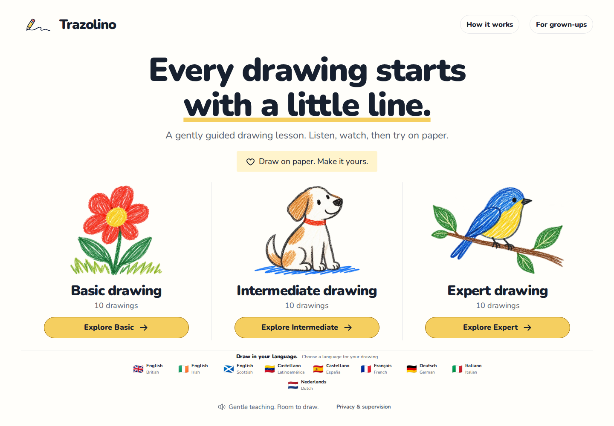
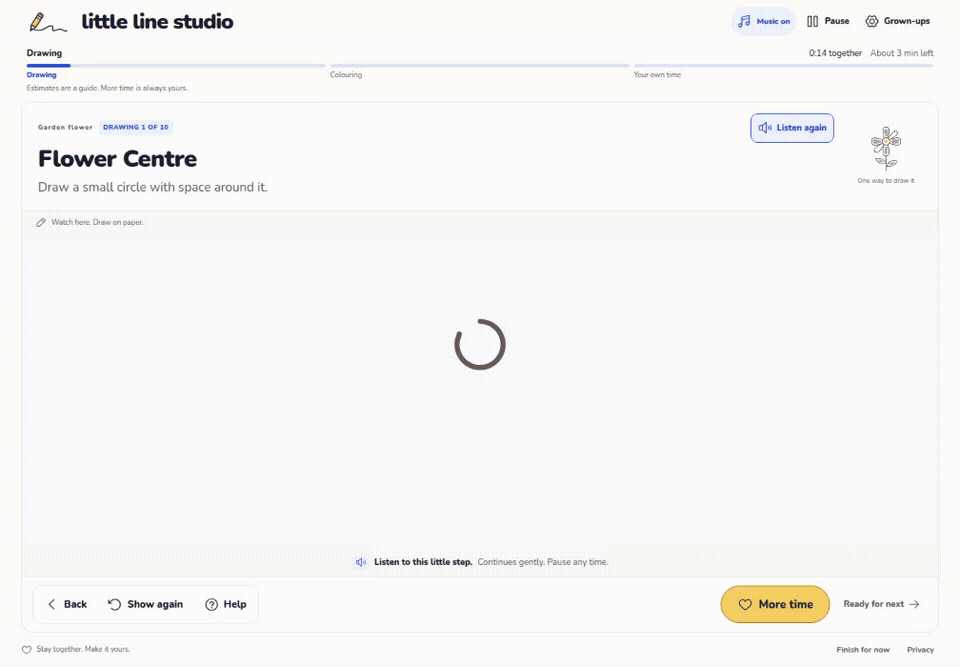
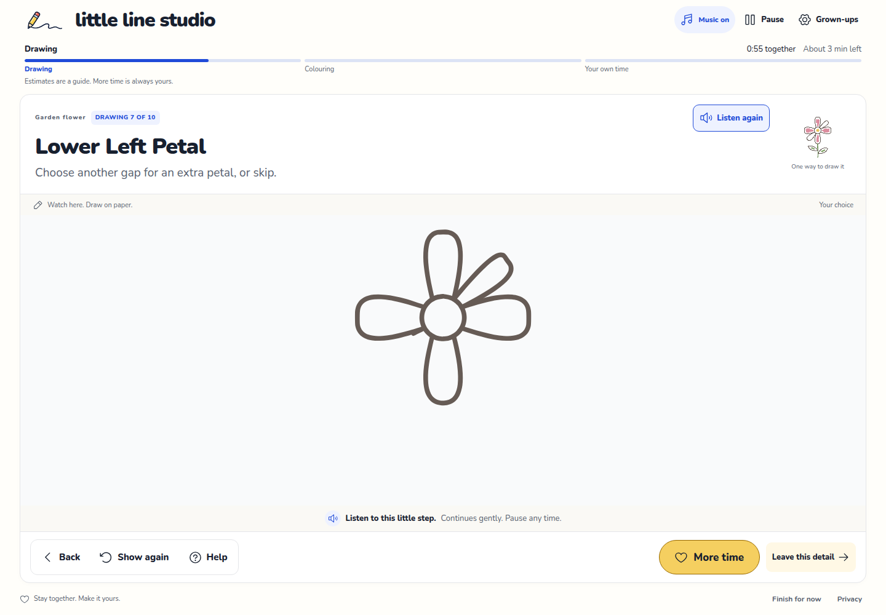

<p align="center">
  
</p>

# Little Line Studio

**A little guidance on screen. A world of imagination on paper.**

Little Line Studio is a parent-supervised drawing teacher. Children draw on real paper while a read-only teaching board demonstrates one small part at a time, with prepared narration, quiet practice and room to make the drawing their own.

[Try Little Line Studio](https://little-line-studio.vercel.app) · [Run locally](#run-locally) · [Deployment guide](docs/deployment.md) · [Lesson authoring guide](DRAWING_LESSON_TEMPLATE.md)



## Our goal

Help families enjoy drawing together and help children build confidence in their own ideas. The screen provides a patient demonstration; the paper belongs to the child. A successful session leaves space for observation, experimentation and a drawing that feels like theirs.

We are building toward accessible, multilingual drawing practice with clear adult controls and minimal data collection. Educational effectiveness is a goal to evaluate with families and educators, not a claim established by the software tests.

## See a lesson



*Recorded from the app. The silent GIF shows a short excerpt; the live lesson includes narration, generous practice time and optional music.*

1. Choose a collection, language and drawing.
2. Gather paper and pencils. An adult confirms they will stay for the session.
3. Watch a small demonstration, listen, then draw on paper.
4. Use **Pause**, **More time**, **Replay** or the optional manual controls whenever needed.
5. Finish with open exploration: add your own details and colours.



## What is included

| Feature | Current release |
| --- | --- |
| Drawing collection | 30 authored lessons: 10 Basic, 10 Intermediate, 10 Expert |
| British, Irish and Scottish English | All 30 lessons, with separate prepared voices and hints |
| Latin American Spanish | All 30 lessons, with Venezuelan-accented Carito narration and hints |
| French | All 30 lessons, with prepared narration and hints |
| Spain Spanish, German, Italian and Dutch | All 30 lessons, with separate prepared voices and hints; see [catalogue coverage](docs/audio-catalogue-status.md) |
| Teaching | Stories, observation, native tldraw demonstrations, colouring and open exploration |
| Sound | Prepared voice recordings and optional instrumental music, served with the site |
| Family controls | Adult setup, unlimited pause/replay/more time, mute and interruption handling |
| Accessibility | Large labelled controls, keyboard focus, reduced motion and text instructions |

The released catalogues have passed automated source, coverage and audio-integrity checks. Independent native-speaker review and full human listening remain pending; French text has received assistant editorial review. Levels describe drawing complexity, not age, ability or an assessment of a child.

## Paper first, parent supervised

An adult must stay with the child throughout the session. The acknowledgement is a local declaration; it does not verify identity or continuous supervision.

The application has no microphone or camera capture, uploads, child accounts, advertising, analytics integrations or stored child profiles. It cannot see or evaluate the paper drawing. Prepared media is played locally in the browser after download; no live AI or generation service runs during a lesson. The hosting provider still handles ordinary web requests and its operational logs.

Application code controls the authored sequence. Voice recordings have no authority to change settings or decide whether a child is ready. Practice windows are adjustable teaching choices, and the family can always pause or add time.

## Run locally

Use **Node.js 24** and npm:

```bash
git clone https://github.com/sergiopesch/little-line-studio.git
cd little-line-studio
npm ci
npm run dev
```

Development on localhost runs the full lesson. For a production build, copy `.env.example` to `.env.local` and supply your own valid `VITE_TLDRAW_LICENSE_KEY`. Without a key, the build intentionally serves the licence-review page and excludes the teaching SDK.

```bash
npm run check     # build, verify prepared audio, run the test suite
npm run preview   # inspect the production build locally
```

For the desktop and small-screen browser regression suite, run `npx playwright install chromium` once, then `npm run test:browser`. It starts its own local development server and needs no licence key or generation credentials. See [verification and evidence](docs/development.md#regression-checks).

The audio and graphics are included, so normal development and playback require no AI-provider account or generation credits. Offline generation tools are separate and require explicit credentials and a bounded budget; see [development](docs/development.md).

## How it is built

React 19 and Vite power the interface. The genuine tldraw SDK renders the read-only teacher board. Authored lesson data and a deterministic controller coordinate demonstration, narration and practice. Fonts, graphics and prepared audio are served from the same origin.

```text
src/          Interface, lesson content, controller and media manifests
public/       Graphics, fonts, SDK assets, narration and music
config/       Shared production and preview security headers
scripts/      Build validation, curriculum and offline media tools
tests/        Controller, content, audio, geometry and deployment checks
research/     Curriculum sources, evidence notes and translation material
docs/         Development, deployment and README media
vercel.json   Hosting configuration; deploys only dist/client
```

Vercel runs `npm run check` before publishing. Failed tests or inconsistent released narration stop the deployment. See [deployment and rollback](docs/deployment.md).

## Project status and rights

This is an evolving family drawing project. Automated checks do not establish educational efficacy, legal compliance, comprehensive accessibility or safeguarding approval. Our next steps are educator/family evaluation, native-language listening review and carefully reviewing additional languages.

The initial hosted release uses a tldraw evaluation licence that expires **8 November 2026**. A replacement production licence is required before it expires. Keys are excluded from this repository, and the SDK's licence enforcement is unchanged. See the [tldraw licensing documentation](https://tldraw.dev/community/license).

Public source availability does not grant a blanket open-source or media licence. Project code and original content have no additional reuse licence granted at present; third-party components retain their own terms. See [third-party notices](THIRD_PARTY_NOTICES.md), [narration provenance](public/narration/NOTICE.md) and [music provenance](public/music/NOTICE.md).
