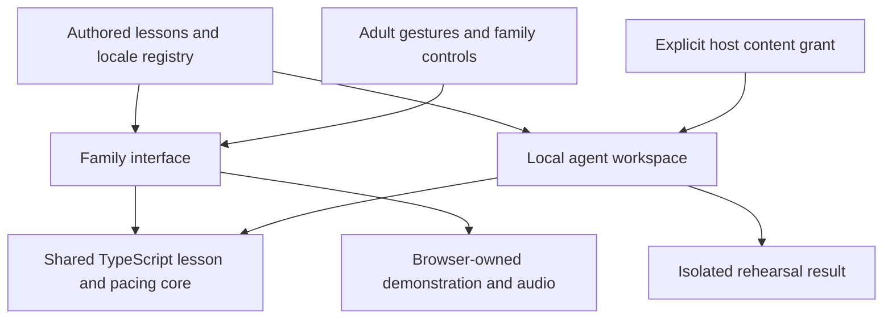

# Shared lesson platform

The family interface and local agent workspace now use the same lesson progression and pacing engine. The platform now has a strict TypeScript core, typed browser playback and language-loading adapters, a strict TypeScript family interface and drawing renderer, and an offline agent adapter. It preserves the current family experience while making authored lessons inspectable and testable without a browser.

## Architecture



`src/core/lesson-engine.ts` owns selection, supervision-gated progression, pause, finish and restart rules. It snapshots catalogue identities so later mutation cannot replace the selected lesson. `src/core/scripted-session.ts` owns narration/demonstration gates, quiet practice, replay identities, holds and interruption behavior. The compatibility entries `src/lesson.js` and `src/scripted-session.js` let the current UI and curriculum tools use that core without duplicating rules.

The browser still owns media effects, visibility handling, rendering, input gestures and its session state. It does not import the agent workspace. The agent adapter has no reference to browser state, audio controllers or deployment/generation tools. Its rehearsal creates temporary state inside the call, supplies simulated media completion, and runs the same reducers until open exploration. This is not an audio audition or rendering test.

The core, protocol, browser playback/loading adapters and family interface run under strict TypeScript with unchecked-index and optional-property checking. `npm run typecheck` runs both `tsconfig.json` (browser-independent core/protocol) and `tsconfig.browser.json` (DOM, React and Vite bundler resolution). `src/browser/` owns typed media lifecycle state, playback hooks, validated language-loading results and generic latest-request cancellation. `src/core/lesson-clock.ts` retains the independent active together-time reducer. Existing `.js` entries re-export these implementations for the UI, tools and tests.

The family screens now live in `src/*.tsx`, with explicit contracts for supervision, settings, level/language selection, lesson progress, dialog focus and asynchronous entry. The root failure screen and licence-review screen are also checked. `src/browser/ui-contracts.ts` describes the authored fields these views consume and the renderer's progress callbacks; the SDK renderer cannot receive a lesson dispatch function through that interface. The old JSX entry paths remain small re-exports so existing lazy-import recovery checks, module identities and tooling stay stable.

The native SDK drawing implementation (`DemonstrationBoard.tsx` and `CrayonDrawShapeUtil.tsx`), geometry sampling, contour expansion, demonstration state and crayon appearance/paint helpers are also strictly checked. `src/drawing/contracts.ts` connects the lesson view to authored geometry and native drawing styles. The SDK retains rendering, pressure, geometry, migrations and licence enforcement; only its supported display-value and SVG-definition extensions are customized. One local assertion covers an installed SDK arrow registration declaration mismatch, without weakening the compiler settings.

Locale registry, authored JavaScript lesson/region producers and localization data are not yet fully typechecked. JSDoc catalogue exports describe the data consumed by the typed interface; they do not validate imported or runtime data. Exact authored-clip membership, locale completeness, geometry/build validation and latest-request checks remain in place. Type fixtures exercise the actual compatibility imports and reject invalid supervision values, selection shapes, volume callbacks, pace values, renderer callbacks, media bindings, narration data, clock identities and unknown thrown values.

The browser configuration uses [bundler module resolution](https://www.typescriptlang.org/tsconfig/moduleResolution) for Vite and dependency declarations; the core retains NodeNext resolution and no DOM globals. React type definitions are pinned to the installed React 19.2 API line, following [React's TypeScript guidance](https://react.dev/learn/typescript); runtime dependencies are unchanged. JavaScript compatibility entries remain intentionally small. TypeScript is a pinned development dependency; it adds no runtime framework or service. Node 24 executes erasable TypeScript directly; Vite handles the browser bundle. See [Node's TypeScript support](https://nodejs.org/api/typescript.html) and [strict checking](https://www.typescriptlang.org/tsconfig/strict.html).

## Local agent interface

Run `node scripts/agent-workspace.mjs --help`. It reads **one** UTF-8 JSON request from stdin and writes one JSON response to stdout. Success exits with code 0; rejection/failure exits with code 1. Input is limited to 4,096 bytes. There is no listening socket or browser endpoint.

Only discovery is enabled by default:

```bash
node scripts/agent-workspace.mjs <<'JSON'
{"version":1,"operation":"describe"}
JSON
```

The descriptor includes the request JSON Schema and actual workspace grants. A host can enable specific operations, locales and lesson identities:

```bash
node scripts/agent-workspace.mjs \
  --locale es-ES --lesson cat --allow inspect_lesson <<'JSON'
{"version":1,"operation":"inspect_lesson","locale":"es-ES","lessonId":"cat"}
JSON
```

```bash
node scripts/agent-workspace.mjs \
  --locale de-DE --lesson cat --allow rehearse_lesson <<'JSON'
{"version":1,"operation":"rehearse_lesson","locale":"de-DE","lessonId":"cat","speed":"slow","still":false,"voice":true}
JSON
```

Repeat flags to grant more entries. No wildcard grant is supported. `list_lessons` returns only granted lessons available in the requested locale. `inspect_lesson` projects the actual localized title, parent note, objective and step text. `rehearse_lesson` returns authored timings, simulated stage transitions and the final open exploration state. Every rehearsal carries `mode: "rehearsal"`, `supervision: "simulated"` and `mediaPlayback: false`.

The local catalogue adapter uses the same explicit locale loaders, availability checks and narration metadata as the family interface. It does not translate text again, choose a fallback language, fetch a URL or turn request strings into file paths. Public inspection is a deliberate field projection, not a spread of internal/provider metadata.

Embedders can call `createAgentWorkspace(catalogue, grant)` and retain its `revoke()` function. The grant is copied at creation. Revocation permanently closes the workspace and suppresses results from outstanding asynchronous loads. Changing a grant requires a new workspace; the request language has no grant-modification operation.

## Security boundary and limits

| Input or threat | Enforced behavior |
| --- | --- |
| A request claims to be a parent or adds `supervised: true` | Unknown fields are rejected; requests cannot claim roles or select permissions |
| A request asks for another lesson, locale or operation | All three dimensions are checked before content is loaded |
| A request contains `publish`, `START`, a path, URL or executable code | No such operation exists; identifiers are bounded and validated |
| A workspace is revoked while loading | The pending result is suppressed |
| A future provider/private field is added to authored data | Inspection returns only explicitly projected public fields |
| A request is malformed, oversized or fails internally | Structured errors; request contents, stack traces and internal error messages are not reflected |
| A late media completion targets an old step/run | Shared pacing rules ignore the mismatched identity |

These are application guarantees for the supported JSON interface. They are **not an operating-system sandbox**, authentication system, or verified parental consent mechanism. The host launching the process owns the flags. An agent with unrestricted shell/filesystem access can launch another process or read public repository files directly; it must not be presented as confined by this grant. For a constrained integration, the trusted host must fix the launch arguments, restrict filesystem/network/process privileges, set an execution deadline and avoid passing credentials. Do not expose this CLI directly as an unauthenticated network service.

The family app continues to have no microphone/camera capture, uploads, accounts, stored child profiles, analytics integration or runtime cloud AI. There is no family-session data path into the agent workspace. Public lesson text is public material, not protected personal information. The local supervision checkbox remains a declaration, not a security credential.

Live assistance is a separate product/security decision. Before implementing it, define the exact information a parent can share, a visible preview, authenticated server-side authorization where applicable, narrow expiring grants, immediate revocation, data retention and independent abuse testing. An agent's own request or a browser-only role flag must never establish that authority. The present implementation deliberately provides no live-session command or network bridge. The [parent-permission design for review](parent-permissions.md) specifies a proposed one-shot sharing preview, host-enforced scope, expiry, revocation and acceptance cases; it is not an implemented permission system.

## Verification and comparison

```bash
npm run typecheck
node --test tests/agent-workspace.test.mjs tests/lesson.test.js tests/scripted-session.test.js
npm run verify:engine-parity
npm run check
npm run test:browser
```

`verify:engine-parity` compares deterministic state transitions and timings with the immutable pre-migration release `2d87262966ef20d5e8c82b997f870e86436ffc26`. It covers all lessons and locales, three pacing settings, still/moving demonstrations, voice/written modes, interruptions, holds, replays and stale events. It reports counts and a local tick microbenchmark. It requires that baseline in local Git history; the normal CI suite is independent of history depth. Use only a trusted baseline SHA: the comparison executes historical source.

The agent tests exercise closed defaults, scope checks, malformed inputs, revocation during loading, non-disclosure of internal fields, CLI byte limits, all localized scripts and rehearsals. Type fixtures require invalid command shapes to fail compilation. Existing regression tests remain the independent specification for the family controls; a before/after comparison alone could preserve an existing bug.

`npm run check` enforces typechecking before build/content/media verification. A no-key build verifies the licence-review package, not the interactive lesson. Browser regression checks exercise the actual development lesson app; a licensed preview is also needed when qualifying deployment. The existing startup budget remains enforced, and agent-only modules must stay outside browser bundles.

Passing these checks establishes bounded compatibility, rejection behavior and test coverage. It does not prove absolute security, educational efficacy, native-speaker quality, full perceptual audio quality or every physical-device lifecycle. Browser tests and human listening remain distinct from rehearsals.

## Why this stage uses TypeScript

The existing React/tldraw experience and authored rules already work. A shared typed core gives both callers identical semantics without introducing a second implementation to keep synchronized. A whole-app Rust rewrite would introduce renderer/binding and parity work without a measured current need. A future Rust or WebAssembly component can be evaluated at a narrow computational boundary using the same compatibility tests; it should earn its place through a measured benefit.

Next stages can type the authored lesson/region and localization producers incrementally, using the existing rendering and content checks as independent regression evidence. A protocol transport around the restricted workspace should be evaluated separately against the parent-permission design. Neither requires opening family-session access. Preserve the authored content, localization identities, audio timing and product controls throughout.
